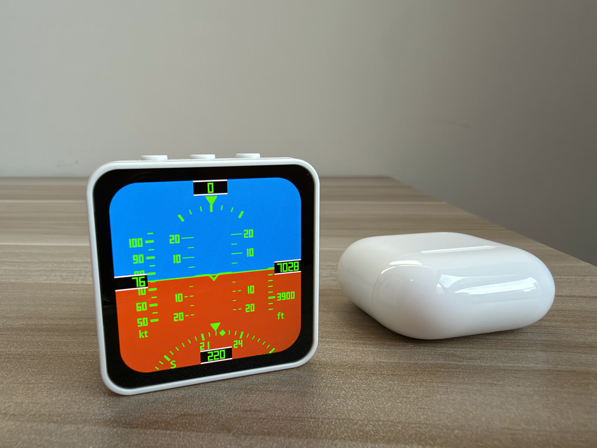
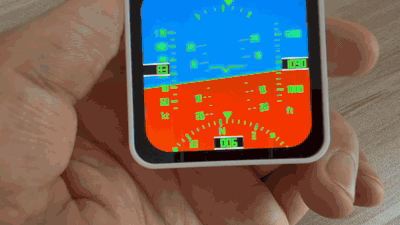

# ESP32-S3 飞机姿态导航仪（AHRS + GPWS 语音告警 + 塔台语音对话）

在 [**ESP32-S3-Touch-AMOLED-2.16**](https://www.waveshare.com/esp32-s3-touch-amoled-2.16.htm?&aff_id=187437)（480×480 AMOLED、QMI8658 六轴 IMU、ES8311 音频 Codec）上实现的仿真飞机地平姿态仪（PFD），UI 刻度与读数逻辑对照 737NG/A320 级别客机真机标准，告警音效采用**真实客机 GPWS 录音**（含进近高度喊话全套）；并可通过 WiFi 与 Mac 端语音管线实时对话——**塔台管制员**（VoxCPM2 克隆真实塔台录音音色 + 电台信道模拟）。





完整演示视频（含塔台语音）：[docs/demo.mp4](docs/demo.mp4)

## 功能

- **地平姿态显示**：蓝天（#1FA9D8）/ 橙地（#BF5A06）随横滚旋转、俯仰平移，俯仰超过 ±35° 饱和为全天/全地（与真仪表一致）
- **中央飞机符号**：客机 "W" 形固定参考符号（短翼 + 深 V 缺口），固定不动，地平线相对它运动
- **俯仰梯**（真机标准）：直横线，地平线上 = 实线（抬头）、下 = 虚线（低头）；±10°/±20° 长线两端标数字，5°/15° 短刻度；所有线在中央 ±48px 断开让开飞机符号（真机 PFD 同款缺口）；可见范围 ±20°
- **横滚刻度弧**（顶部）：0/±10/±20/±30 共 7 个刻度（0/±30 加粗），固定不动；荧光绿实心倒三角指针随坡度摆动指向当前横滚角（真机式：刻度固定、指针动）
- **左侧空速带**：节（kt），量程 0-160，短刻度 5 kt / 长刻度+数字 10 kt（主流客机标准）
- **右侧海拔带**：英尺（ft），量程 -500~6000，短刻度 20 ft / 长刻度+数字 100 ft（真机标准）
- **底部罗盘**：倒扣半月环，刻度 5°/格、数字/字母每 30°（N/E/S/W 为 B612 粗体字母，度数为七段数码管），45° 方向（NE/SE/SW/NW）为实心小方块定位点（替代刻度线）；盘转针不动，中央实心倒三角指当前航向
- **四个数值读数窗**：黑底荧光绿七段数码管，白线描边贴屏幕边缘；左右窗数字与刻度带数字同列对齐（滚动时"滑入"读数列）
- **全屏统一荧光绿**（#39FF14）+ 七段数码管数字 + B612（空客驾驶舱开源字体）字母
- **任意持握姿势自适配**：重力投影姿态解算（Madgwick），平放/竖拿自动识别
- **校准**：开机自动校准姿态零点 + **陀螺仪零偏**（校准窗口保持静止）；点触屏幕重新校准——先播"断开自动驾驶"警报（接管手飞），完成后"叮"一声；静止时零偏在线学习兜底

## 塔台语音对话（PTT，塔台管制员）

按住机身 **KEY（GPIO18）说话，松开发送**，Mac 端语音管线识别后由"塔台管制员"实时回复，设备扬声器播放。呼号：**电磁波001号**（塔台回话用航空读法「电磁波洞洞幺」）。

- **状态点**（顶部俯仰读数窗右侧，28px 实心圆）：红 = 录音中 / 黄 = 等待回复 / 绿 = 播报中（说完才灭）/ 隐藏 = 空闲
- **链路**：设备 ES8311 录音（16kHz 16bit mono）→ WiFi TCP（`:7890`）→ **Qwen3-ASR-1.7B**（MLX int8 本地）→ **MiniCPM5-2B**（塔台员人设）→ **VoxCPM2** 克隆合成 → AUD1 帧流式回发播放
- **实时飞行数据**：发语音前设备先发一帧 `STA0`（高度/速度/航向/俯仰/横滚/垂直速度），服务端注入 LLM 上下文——塔台"看着仪表说话"：判断飞行阶段、指出请求与数据的矛盾（如"你已经在 1693 米空中"）、数据异动主动提醒（猛爬升/猛下降→改平，大坡度→注意坡度）
- **LLM 话术设计**（`SYSTEM_PROMPT`）：标准陆空通话词汇白名单 + few-shot 示例（含矛盾处置）+ 每轮"处置方向"导演提示（防 2B 小模型自我复读，措辞与判断仍归 LLM）
- **数字确定性转换**：LLM 只输出阿拉伯数字，服务端 `to_spoken()` 逐位转航空读法（0→洞 1→幺 2→两 7→拐 .→点），数字永不出错（radar 仓同款思路）
- **克隆音色**：`voice-chat/ref_tower.wav`（真实塔台录音 0.15~10.15s 干净段，起止对齐句界防残句泄漏），人工校对逐字稿 `REF_TEXT` 随 `ref_audio` 一起传
- **电台信道模拟**：300Hz~3.4kHz 窄带 + tanh 软限幅（`RADIO_DRIVE`）→ 可选降速（`RADIO_TEMPO`，默认 1.0）→ 全频白噪底噪（`RADIO_HISS`）+ 结尾静噪尾音 shhk。**噪声必须在降速插值之后加，否则高频嘶声被平滑掉**
- **设备播放**：字节级 192KB 环形缓冲 + 背压（旧"环形区+描述符队列"在网络快于播放时会覆盖未播块，新旧描述符指向同段内存导致句中单词重复，已根治）
- 回复结束后设备自动断开重连（保活 TCP 连接存在"第一流后下行哑死"问题，换新连接根治）
- 对话期间可随时按 KEY 抢话；10s 无回复自动回空闲

```bash
cd voice-chat
python3 -m venv .venv && .venv/bin/pip install mlx-speech numpy
export MODELBEST_API_KEY=sk-...        # 面壁平台（不要开系统代理，代码已强制直连）
.venv/bin/python server.py             # 监听 :7890，等设备接入
```

设备端 WiFi 凭据与服务器 IP 在 `firmware/main/voice_secrets.h`（git 已忽略）——克隆后复制 `voice_secrets.example.h` 为 `voice_secrets.h` 填入自己的值。克隆参考音 `ref_tower.wav` 属个人素材、仓库不附带，需自行准备 16kHz 单声道 WAV（6~10 秒、起止对齐句界）放到 `voice-chat/`，并把 `server.py` 里 `REF_TEXT` 改成对应逐字稿。

## 语音告警（真实客机 GPWS 录音）

音频来自飞行模拟社区提取的真机 GPWS 声音包（`voice-pipeline/gpws_raw/`，仅供个人把玩，勿商用再分发）。

### 告警（优先级从高到低，同时满足时只报最紧急的）

| 告警 | 触发条件 | 音频 |
|------|---------|------|
| PULL UP | 下降率 >20 m/s 且高度 <984ft（低空猛俯冲） | whoop + "PULL UP" |
| OVERSPEED | 空速 >200 km/h / 108 kt | 超速 clacker 咔咔警告声（该机真机超速为纯警告声、无人声喊话） |
| STALL | 空速 <70 km/h / 38 kt（大抬头爬升掉速度触发，符合真实逻辑） | 抖杆器（机关枪声）+ "STALL" |
| SINK RATE | 下降率 >16 m/s 且高度 <2625ft | "SINK RATE" |
| BANK ANGLE | 横滚 >45° | "BANK ANGLE" |
| PITCH | 俯仰 >30° 或 <-25° | master alarm 提示音 |

### 进近高度喊话（主流客机标准点位，仅下降穿越时播报）

2500 → 1000 → 500 → 400 → 300 → **200ft = "MINIMUMS"**（决断高度）→ 100 → 50 → 40 → 30 → 20 → 10 → 5 ft

- 穿越检测：爬升回去自动重臂；PULL_UP/OVERSPEED/STALL 期间喊话让路，其余告警与喊话排队播放
- 按 **KEY（GPIO18）= PTT 塔台对话**（见上节）；**触屏 = 重新校准**：先播"断开自动驾驶"警报声（接管手飞），校准完成后"叮"
- 开机：自检提示音

### 语音管线（可选：AI 克隆路线）

`voice-pipeline/` 里保留了完整的大模型克隆管线（面壁平台），可随时替换音色：

- **文案**：MiniCPM5-2B 生成，精选入 `voice_manifest.json`
- **音色**：VoxCPM2 克隆（`/v1/audio/speech`，SSE 流式）。参考音：`ref_ting.wav`（macOS 婷婷中文女声，音质最稳）、`ref_*.wav`（真实座舱录音，底噪大会影响克隆质量）
- 注意：参考音控制在 6-10 秒（16kHz 单声道），payload 过大（>600KB）服务端会断连；脚本已强制直连（urllib 在 macOS 会读系统代理）

```bash
export MODELBEST_API_KEY=sk-...
python3 voice-pipeline/gen_texts.py --model MiniCPM5-2B   # 生成文案（可选）
python3 voice-pipeline/gen_voice.py --ref ref_ting_6s.wav # 克隆合成 -> assets/*.wav
tools/pack_voice.sh --spiffs                              # 打进固件镜像
```

## 固件架构（ESP-IDF v5.5 + LVGL 9.6）

```
firmware/main/
├── main.c            # 启动流程、UI 任务（持锁刷新）
├── qmi8658.c/h       # IMU 驱动（400kHz I2C，±4g / ±512dps）
├── madgwick.c/h      # Madgwick 姿态融合 + 重力向量
├── flight_state.c/h  # 共享姿态状态 + 演示飞行模型（俯仰驱动空速/海拔/下降率）
│                     # + 零点/陀螺零偏校准 + 静止零偏学习
├── ui_ahrs.c/h       # 全对象化 UI（预渲染图片 + 属性更新，无运行时画布）
│                     # 自研七段数码管渲染（seg_draw_text）
├── ui_font_b612_24.c # B612 Bold 24px（单位标签 kt/ft，LVGL 字体）
├── ui_font_b612_28.c # B612 Bold 28px（罗盘 N/E/S/W）
├── alert.c/h         # 告警状态机 + 高度喊话穿越检测
├── voice_link.c/h    # PTT 塔台对话：GPIO18 录音/发送、STA0 飞行数据帧、TCP 收发、状态点
└── audio_out.c/h     # 极简 WAV 播放 + 字节环形缓冲流式播放（背压防覆盖，ES8311/I2S 16kHz mono）
```

关键设计：

- **UI 零运行时画布绘制**：地平线/刻度带/罗盘环/横滚刻度都是初始化时预渲染的图片，运行时只做 `lv_image_set_rotation / set_offset / set_pos`，避免绘制管线异步状态损坏导致的 QSPI 事务泄漏（白屏根因）
- **地平线自研旋转渲染**：`render_horizon()` 定点数重采样（绕开 LVGL 大图 transform 在 90° 附近的渲染 bug 与偏心 pivot 裁剪 bug）；取整用 +0.5 四舍五入（floor 会在旋转中心产生 1px 台阶），采样坐标钳制防越界
- **横滚刻度为独立固定层**：刻度弧不在旋转卡片上（不随俯仰漂移），指针是绕弧心旋转的小图片（`lv_image_set_rotation` + 偏心 pivot）
- **陀螺零偏两级补偿**：QMI8658 零偏达数 °/s，开机校准窗口直接测量并永久扣除；静止时（三轴 < 3.5°/s）慢速在线学习残余零偏。无磁力计的纯积分航向因此静止不漂
- **自定义 LVGL 字体**：`lv_font_conv --no-compress`（压缩字体不走 static_bitmap 路径会不显示），生成后需补 `.static_bitmap=1` / `cap_height` / `x_height` 字段并对齐 LVGL 9.6 结构体；堆分配的 `lv_image_dsc_t` 必须 memset 清零（`header.flags` 垃圾值会触发解码器误判拒渲染）
- **内部 DMA RAM 绘制缓冲**：LVGL draw buffers 放内部 RAM（BSP patch `use_psram=false` + `trans_queue_depth=10`），否则 SPI 驱动逐 chunk 弹跳 PSRAM→内部，内部 RAM 不足时 chunks 丢失白屏；音频用极简 WAV 流（弃 esp-audio-player 的 helix 解码器）、不挂 SDMMC 为其腾出空间
- **音频格式匹配**：语音文件全部 16kHz 16bit 单声道，codec 需显式 `set_fs(16000,16,1)`（BSP 默认双声道，不改会两倍速变声）

## 编译烧录

```bash
source ~/esp/esp-idf/export.sh   # ESP-IDF v5.5.2
cd firmware
idf.py set-target esp32s3 build
idf.py -p /dev/cu.usbmodemXXXX flash monitor
```

首次编译前准备两样东西：

1. **GPWS 音频**：音频版权属原厂商、仓库不附带，需自行从模拟飞行社区获取后放入 `firmware/spiffs_image/voice/`（命名对照 `voice-pipeline/voice_manifest.json`），或走 `voice-pipeline/` 的 AI 克隆管线自生成
2. **语音对话凭据**（可选，不玩塔台对话可跳过）：`cp main/voice_secrets.example.h main/voice_secrets.h` 并填入 WiFi 与服务器 IP

依赖（IDF 组件管理器自动拉取）：`waveshare/esp32_s3_touch_amoled_2_16`、`lvgl/lvgl 9.*`。

串口失联时进下载模式：按住 BOOT → 短按 PWR → 松开 BOOT。

## 已知取舍

- 空速/海拔/下降率为**演示模型**（俯仰驱动：俯冲增速降高、爬升减速升高），板子没有空速管/气压计；内部物理量用公制运算，显示层换算为 kt/ft
- 航向为**相对航向**：陀螺仪绕重力轴积分 + 零偏补偿，静止不漂、转动准确，但不指北（无磁力计）；温度变化可能引起极缓慢漂移
- 俯仰超过 ±35° 画面饱和为全天/全地（与真仪表一致）
- 罗盘/横滚读数为演示精度（约 ±1°），非导航级
- GPWS 音频版权属于原厂商（霍尼韦尔等原厂商），本仓库不附带，需自行从模拟飞行社区获取
